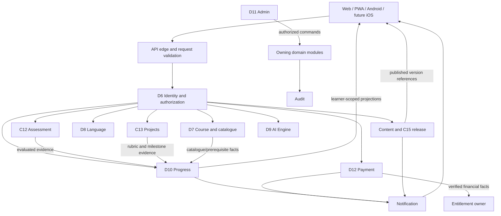

# D14 — End-to-End System Data Flow

**Status:** Complete at logical end-to-end data-flow and contract specification scope  
**Date:** 2026-11-05  
**Depends on:** D1–D13  
**Decision:** D-0012  
**Baseline:** TypeScript strict; Next.js web/PWA; Expo native; NestJS modular monolith; PostgreSQL/Prisma ORM 7; REST/JSON `/api/v1`; provider-neutral adapters; D13 outbox/inbox communication  
**Scope boundary:** Logical flows, ownership, trust boundaries, state transitions, consistency, failure/recovery and future acceptance tests only. No endpoint, database migration, worker, provider, UI, queue, deployment or production integration is implemented.

## 1. Purpose and governing rules

D14 connects the previously approved module architectures into end-to-end journeys. It describes which actor initiates a flow, which module owns each decision and record, how data crosses module boundaries, what is synchronous versus asynchronous, what the learner sees, and how failures are recovered without corrupting authoritative state.

1. The owning module is the only authority allowed to create or change its domain state.
2. Web, PWA and native clients are untrusted presentation channels. They never write directly to PostgreSQL or decide permissions, payment success, entitlement, assessment outcome, completion or mastery.
3. Every cross-module interaction follows a D5 API contract or D13 application port/event contract. No direct cross-module repository/table access.
4. Identity is resolved to a server-side principal under D6. Client-supplied user IDs, roles, locale, plan, score and entitlement are not authoritative.
5. Published curriculum/content is immutable and version-bound. Drafts and AI suggestions are not learner-visible published truth.
6. Assessment evidence is recorded by the assessment owner; progress consumes versioned evidence and owns progress projections/policies.
7. Payment owns financial facts. Entitlement owns effective access decisions. A payment event is not itself an access grant.
8. Events are at-least-once; consumers are idempotent. Eventual consistency and pending states are visible where relevant.
9. External providers, user inputs, uploads, code, webhooks, AI outputs and event payloads are untrusted until validated.
10. Sensitive data is minimized in events, logs, traces, notifications and analytics.
11. Failure must not silently produce success, erase evidence, bypass approval or grant access.
12. Tests listed here are future acceptance scenarios; they are not represented as executed.

## 2. System context and module authority

| Data / decision | Authoritative owner | Other modules may |
|---|---|---|
| External identity mapping, principal, account state, session and role assignments | D6 Identity | Consume validated principal/permission context |
| Curriculum taxonomy, prerequisite graph and catalogue release | D7 Course/Curriculum | Read published version and prerequisite results through contracts |
| Lesson body, localized lesson versions and publication state | Content + C15 review/release authority | Read eligible published versions |
| Supported locale, locale resolution and parity policy | D8 Language | Request locale resolution and validated localized versions |
| AI task execution, provider usage and generated draft output | D9 AI | Request bounded assistance; validate and review output |
| Assessment attempt, answer evaluation and score evidence | C12 Assessment | Send evaluated evidence to D10 |
| Project brief, submission and rubric evidence | C13 Project | Send versioned milestone/rubric evidence to D10 |
| Learner activity evidence, completion/mastery policy and progress projections | D10 Progress | Submit evidence; read learner-scoped projections |
| Admin workspace actions, scoped permissions and operational commands | D11 Admin + each target domain owner | Orchestrate authorized commands; cannot bypass target owner |
| Order, payment, refund and subscription financial facts | D12 Payment | Receive verified status facts |
| Effective access grants and revocations | Entitlement domain (separate from Payment) | Query access decision; process D12 facts idempotently |
| Notification preference, delivery request and delivery outcome | Notification domain | Request delivery of approved, minimal messages |
| Security/privileged audit evidence | Audit policy and owning domain | Append or consume approved audit facts |

**Important:** D11 is an administrative interface/orchestration boundary, not a superuser data owner. D12 cannot edit entitlement records. D10 cannot rewrite assessment/project evidence. AI cannot approve, publish, grade or grant permissions. C15 remains the publication authority.

## 3. End-to-end context map

The diagram is logical, not a deployment topology. D13 defines how module calls and events are transported. D3 defines runtime boundaries; D4 defines persistence ownership; D5 defines external API contract conventions.

## 4. Shared request, identity and data envelope

### 4.1 Request lifecycle

1. Client sends HTTPS request with a supported API version, request metadata and authentication material selected by the future D6 implementation decision.
2. API edge enforces payload-size, content-type, origin/CSRF policy where applicable, rate and schema limits.
3. D6 adapter validates authentication and resolves the internal principal. Anonymous access is allowed only on explicitly public routes.
4. Account status, permission, resource ownership, scope, assurance/freshness and workflow-state checks are evaluated server-side.
5. The target module validates its own invariants and executes its use case.
6. The owner commits its state and any required outbox event atomically.
7. API returns a stable D5 response envelope and correlation/request identifier. Long-running work returns an accepted/pending resource reference rather than fabricated completion.
8. Client renders only the returned authorized representation; it does not infer success from a timeout or optimistic local state.

### 4.2 Required logical context

- `requestId`: unique API request identifier.
- `correlationId`: end-to-end workflow identifier propagated across sync and async hops.
- `causationId`: command/event that caused the current action, where applicable.
- `principalId`: server-resolved internal UUID or explicit anonymous/service actor context.
- `actorType`: human, service or anonymous where policy permits.
- `locale`: validated supported locale context, not an authorization claim.
- `resourceVersion`: immutable/version or optimistic-concurrency reference when needed.
- `idempotencyKey`: client/command-supplied key for retryable side-effecting operations, scoped to actor and operation.
- `traceContext`: validated trace propagation fields; never credentials or secrets.

Do not place access tokens, refresh tokens, passwords, OTPs, payment card data, CVV, raw provider secrets or unrestricted personal data in the envelope.

### 4.3 Common response states

Use D5's stable error/response envelope. At the domain level distinguish: `SUCCEEDED`, `ACCEPTED/PENDING`, `REJECTED`, `RETRYABLE_FAILURE`, `REQUIRES_RECONCILIATION`, `EXPIRED` and `REVOKED` as appropriate. These are conceptual outcomes, not a declaration that exact enum strings have been added to D5. Never return success while the authoritative owner is uncertain.

## 5. Flow A — Registration, authentication and learner setup

**Trigger:** Visitor selects Register or Sign in on web/PWA/native.

1. Client submits the supported identity-provider flow initiation. It does not submit an authoritative principal or role.
2. D6 identity adapter validates protocol response (issuer, audience, signature, state/nonce, expiry and redirect constraints) and maps the external `(issuer, subject)` pair to an internal principal.
3. D6 evaluates account state, verification and onboarding requirements. New accounts remain pending until required checks pass; activation is an explicit audited transition.
4. Learner profile/preferences are created or updated by their owning profile capability using the resolved principal. Requested locale is validated against D8's six-locale allowlist.
5. API returns a safe learner session/profile representation. D7 course catalogue and public published content may be browsed according to public policy; protected actions require an active principal and authorization.
6. Audit records security-relevant lifecycle changes. Notification may send verification or security messages using approved templates and minimal recipient data.

**Ownership and invariants**
- D6 owns identity links, account state, sessions and role assignments.
- A profile is not an identity credential store.
- Email/phone are contact attributes, not primary identity keys.
- Same email from different issuers must not silently auto-link accounts.
- Learner role/profile creation never grants author, reviewer, publisher or admin permissions.

**Failure and recovery**
- Invalid provider response, disabled account or unresolved identity fails closed.
- Duplicate registration is handled without account enumeration.
- Provider outage does not activate insecure local authentication fallback.
- A retry must not create duplicate principals, profiles or verification actions.

## 6. Flow B — Course discovery, selection and published content delivery

**Trigger:** Authenticated or public learner browses catalogue, opens a course or selects a learning path.

1. Client requests the catalogue with supported locale and filters.
2. D7 returns only currently published catalogue/release versions and eligible pathway metadata. Draft or withdrawn material is not returned as published.
3. D8 resolves UI/content locale according to its explicit fallback policy. The response identifies the actual locale/version served; it must not silently imply a translation exists.
4. Learner selects a course/pathway. D7 checks publication state, learner eligibility and B11 prerequisite edges using server-side facts. The client cannot self-assert prerequisite completion.
5. D7 records an idempotent enrolment/pathway selection if the feature requires persistence. The chosen catalogue version is pinned according to D7's version policy.
6. Content delivery resolves the requested lesson/topic against the published release and returns a versioned, authorized lesson representation.
7. D10 may receive a course/pathway selection event or query the D7 snapshot for progress context, following its contract. Selection alone must not be misreported as lesson completion or mastery.
8. Cache may store only approved public/published content under versioned keys. Protected learner data and unpublished drafts are not placed in shared public caches.

**Invariants**
- D7 owns course structure, prerequisite graph and catalogue release.
- Content/C15 owns lesson release eligibility and approved localized version.
- D8 owns locale resolution and parity rules.
- A lesson reference includes stable identity plus immutable version; stale links are resolved or rejected explicitly.
- No content is exposed before mandatory C15 approval gates pass.

**Failure and recovery**
- Missing locale version returns an explicit fallback/unavailable state consistent with D8 policy.
- Stale catalogue/lesson version prompts a safe refresh; do not silently substitute a materially different version.
- Prerequisite evaluation unavailable fails closed for gated enrolment, but public catalogue browsing can remain available.
- Withdrawn or quarantined content is not served from stale cache; invalidation/version policy must prevent continued exposure.

## 7. Flow C — Lesson, exercise, assessment and progress

**Trigger:** Learner opens a lesson, performs an exercise or submits an assessment.

1. Content service returns the current published lesson version and its structured learning activities. Client records local interaction state only as a UI convenience.
2. Exercise request includes activity ID, lesson/content version and submission reference. The activity/assessment owner validates the published activity version and learner scope.
3. For objective assessment, C12 validates the attempt and evaluates against the authoritative rubric/rules. For project evidence, C13 validates the submission and rubric workflow. The browser's displayed score is never authoritative.
4. C12/C13 persists an immutable attempt/submission/evaluation record with version references, actor, timestamps and idempotency identity.
5. In the same local transaction, the producer writes a D13 outbox event when progress ingestion is required.
6. D10 consumes the event through its inbox, validates source/version/learner scope and records append-only evidence. Duplicate delivery does not create duplicate evidence.
7. D10 applies the approved versioned completion/mastery policy, prerequisite rules and stale-evidence policy. It updates/rebuilds learner-scoped projections without modifying source assessment/project records.
8. Learner queries progress from D10. API clearly distinguishes activity attempted, completed, mastery achieved, pending evaluation and recalculation/stale states.
9. Notifications/achievements may be triggered from approved D10 events, but delivery failure cannot roll back assessment evidence.

**Invariants**
- C12 owns assessment attempt and evaluated score; C13 owns project submission and rubric evidence.
- D10 owns progress evidence ingestion and projections, not source assessment truth.
- Evidence is bound to learner, activity, content/rubric/policy versions and source record.
- No client-side score, completion percentage or mastery assertion can update D10.
- No universal mastery threshold is introduced by D14; D10 policy remains authoritative.
- Offline writes are not authoritative until separately designed and approved.

**Failure and recovery**
- Assessment submission timeout is an unknown outcome, not proof of failure. Client checks attempt status using idempotency/reference before resubmitting.
- Duplicate submit returns the same logical attempt/result where key scope permits.
- Outbox delivery delay displays pending progress synchronization; source evidence remains saved.
- D10 consumer outage is recovered through retry/reconciliation. Do not ask learner to repeat an already persisted attempt.
- Invalid, stale or out-of-scope evidence is quarantined/rejected with an audit-safe reason; no fabricated progress.
- Projection rebuild uses immutable evidence and policy version; corrections are new evidence/recalculation records, not silent history edits.

## 8. Flow D — AI Tutor and AI-assisted content/localization

### 8.1 Learner-facing AI Tutor

1. Client sends a bounded question plus authorized lesson/context references and selected locale.
2. D6 authorizes the learner and D9 validates task class, quotas, data classification, context references and request schema.
3. D9 retrieves only the minimum permitted published context through owning-module contracts. User-supplied text, code, uploads and retrieved content are treated as untrusted instructions/data.
4. D9 applies prompt-injection defenses, context separation, output limits and provider policy. Provider calls occur outside long-running database transactions.
5. D9 validates output shape, safety and language/technical constraints. If the task cannot be safely answered, it returns a bounded refusal/clarification or escalates to an approved non-AI path.
6. D8 locale policy and C9 terminology governance inform language output; code identifiers, syntax and protected tokens are preserved.
7. API returns the answer with task/usage metadata permitted by policy. Usage and cost records are associated with the authorized actor/task without logging raw secrets or unnecessary prompt content.

### 8.2 AI-assisted authoring/localization

1. Authorized author/editor submits a draft or localization request referencing a specific source version.
2. D9 produces a draft suggestion only; it cannot modify the approved source version, change curriculum scope, evaluate mastery, approve a review gate or publish.
3. Content/locale owners validate schema, provenance, code-token fidelity, semantic parity and C14 quality evidence.
4. C15 routes the exact immutable candidate hash to required independent reviewers.
5. Only authorized human review and release transitions can publish the candidate.
6. Any edit after approval changes the hash/version and invalidates affected approval evidence according to C15 rules.

**Failure and recovery**
- Provider timeout is recorded as unknown/retryable according to idempotency; avoid duplicate billable work where provider capability allows.
- Unsafe/injected output is discarded or quarantined; never render untrusted HTML or execute generated code on the API server.
- Quota exhaustion returns a clear limit state and safe non-AI learning path.
- AI provider outage must not block ordinary course delivery, saved progress or non-AI assessment.
- Draft generation failure never changes published content or review status.

## 9. Flow E — Payment, refund, subscription and entitlement

**Trigger:** Learner chooses an optional paid plan or initiates a refund/cancellation action.

1. Client requests available plan/price information. D12 returns server-owned active plan/price versions; client-supplied amount, currency, discount or entitlement is ignored.
2. D12 creates an immutable order/checkout intent with learner, plan/price version, amount/currency snapshot, idempotency key and pending state.
3. D12 requests a provider-hosted checkout session through a provider adapter. Do not expose secret keys or accept card data in platform services unless a separately approved PCI design explicitly permits it.
4. Client redirects/opens provider checkout. Browser return/success page is informational only and cannot mark payment paid.
5. Provider webhook enters isolated ingress. D12 verifies signature against the exact raw body, timestamp/replay policy and provider account context before durable acceptance.
6. Verified provider event is persisted idempotently in D12's durable inbox; the financial state transition and outbox fact commit atomically.
7. D12 emits a minimal `payment.succeeded`, `payment.failed`, `refund.succeeded`, `subscription.activated`, `subscription.cancelled` or equivalent versioned fact only after its authoritative transition.
8. Entitlement owner consumes the fact idempotently, validates order/learner/plan references and policy, then creates/updates/revokes the effective entitlement record.
9. Learner API queries entitlement owner for access decisions. Every protected premium resource checks effective entitlement server-side at request time or through a bounded, invalidatable authorization projection.
10. Notification informs the learner of confirmed financial/access state. Invoice/tax artifacts follow D12's separately approved financial policy.
11. Refund, chargeback, cancellation, expiry and provider reconciliation produce new financial facts and corresponding entitlement transitions. They never rewrite payment history.

**Critical invariants**
- D12 is the financial source of truth; entitlement owner is the access source of truth.
- Redirect query parameters, screenshots, client state and unverified webhook payloads cannot grant access.
- A payment can be succeeded while entitlement is still pending propagation; UI must show this honestly and provide safe status refresh.
- Refund/chargeback policy determines entitlement effect; do not assume every partial refund has the same result.
- Duplicate webhook/event delivery cannot duplicate charges, refunds, invoices or entitlements.
- No card number, CVV, OTP, provider secret or authentication token in events/logs.

**Failure and recovery**
- Checkout creation timeout is checked by idempotency/status before creating another checkout.
- Webhook verification failure is rejected and audited; it cannot alter financial state.
- Webhook accepted but downstream entitlement delayed remains pending and is retried/reconciled.
- Provider and internal records are reconciled using provider references; reconciliation flags discrepancy for controlled resolution, not invented success.
- Refund succeeded but entitlement revocation delayed is an urgent consistency incident with alerting and bounded access policy.
- Provider outage never causes a default premium grant.

## 10. Flow F — Admin review, approval and publishing

**Trigger:** Author/editor submits a content version or an authorized operator manages a release.

1. Author creates/updates a draft in the content owner. Draft is versioned and not publicly retrievable.
2. Submission creates an immutable review package with source references, locale versions, asset/code metadata, C14 evaluation evidence and content hash.
3. D11 admin workspace displays only items permitted by the operator's server-side role, scope and assigned queue.
4. C15 validates submission completeness, current hash, locale requirements, reviewer assignment and separation-of-duties.
5. Reviewers inspect the exact candidate version and record gate-specific decisions. Author cannot approve their own work; AI/system actors cannot impersonate human review.
6. Revisions create a new candidate/hash and return through the required review gates. Previous decisions remain auditable and cannot be silently carried to a changed hash.
7. C15 evaluates all mandatory gates and release policy. Authorized publisher issues a release command; content owner publishes the approved immutable version.
8. D7 catalogue release references the eligible lesson/content version where applicable. Cache invalidation and release events propagate through D13.
9. Learner-facing delivery resolves only the currently eligible published version. Withdrawal/rollback creates an audited state transition and stops future delivery under the release policy.

**Failure and recovery**
- Reviewer service or queue outage leaves the item pending; it must not auto-approve.
- Stale hash, missing locale gate, reviewer conflict or expired authority blocks publication.
- Publish command timeout is reconciled by release ID/version before retry; duplicate publish commands are idempotent.
- Partial cache invalidation cannot make an unapproved version visible; delivery checks release eligibility.
- Emergency withdrawal is a privileged audited command; restore requires a new authorized decision.

## 11. Flow G — Notifications and learner communication

1. Owning module commits a domain transition and an outbox event (for example, verified account, assessment result, release update, payment/refund state or entitlement change).
2. Notification domain consumes the event, validates its schema/version and checks event purpose, recipient reference, preference, channel eligibility and rate policy.
3. It creates a minimal notification job with template/version, locale, deduplication key and delivery state.
4. Locale/template resolution follows D8; fallback must be explicit and must not misrepresent an unavailable translation.
5. Provider adapter sends only approved content and necessary destination data. No secrets, full assessment answers, sensitive AI prompts or payment details are included.
6. Delivery attempt/result is recorded. Retry is bounded and deduplicated. Permanent failures enter a restricted operational queue.
7. In-app notification reads are authenticated and recipient-scoped. Email/push provider delivery does not prove the learner read or acted on the message.

**Failure and recovery**
- Duplicate event/job does not create duplicate logical notifications.
- Provider outage delays delivery without rolling back source state.
- Invalid locale template uses approved fallback or records unavailable; no machine-generated unreviewed critical legal/financial wording.
- Preference/consent and suppression rules are checked at send time where required.
- Delivery status is distinct from read status and business completion.

## 12. Flow H — Error handling, recovery, reconciliation and audit

### 12.1 Failure classification

| Class | Example | Required behavior |
|---|---|---|
| Validation/permanent | Invalid schema, unsupported locale, malformed request | Reject; do not retry unchanged input |
| Authentication/authorization | Expired session, wrong role/scope | Fail closed; safe client action; security audit where appropriate |
| Conflict/stale version | Changed lesson hash, duplicate state transition | Return stable conflict/current state; refresh or reconcile |
| Transient dependency | Timeout, provider 5xx, temporary DB/worker outage | Bounded retry with backoff/jitter and idempotency |
| Unknown side-effect outcome | Checkout/assessment/publish timeout after request | Query authoritative operation status before retry |
| Poison event | Unknown event version or invalid payload | Quarantine, alert and controlled operator review |
| Data discrepancy | Payment/provider mismatch, missing progress event | Reconciliation case; preserve both source facts |
| Security incident | Forged webhook, replay, IDOR attempt | Reject, rate-limit/contain, append audit evidence and alert |

### 12.2 Recovery sequence

1. Preserve the original request/event/aggregate reference and correlation ID.
2. Determine whether the authoritative transaction committed; do not infer from client timeout.
3. Read current state from the owning module.
4. If safe, retry the same idempotent operation with the same key/event identity.
5. For async delivery, use D13 inbox/outbox retry and quarantine rules.
6. For cross-domain mismatch, create a reconciliation case with source references and evidence.
7. Use compensating domain actions only through the owning module and approved policy; never cross-module database rollback.
8. Record operator, reason, before/after references and outcome for privileged replay/compensation.
9. Notify the learner only with a verified, privacy-safe state.
10. Close incident only after source-of-truth state and dependent projections are reconciled.

### 12.3 Audit requirements

Audit security-sensitive identity/role changes, assessment corrections, progress policy changes, payment/refund/reconciliation, entitlement grants/revocations, AI administrative settings, reviewer decisions, publication/withdrawal, dead-letter replay and compensating actions. Audit records are append-only by policy, access-controlled and minimized. Operational logs/traces are not substitutes for business audit evidence.

## 13. Consistency, idempotency and data lifecycle matrix

| Journey | Consistency requirement | Idempotency / version key | Reconciliation owner |
|---|---|---|---|
| Registration/identity link | D6 local transaction | issuer+subject; operation key | D6 |
| Enrolment/pathway selection | D7 authoritative state | principal+pathway+catalogue version | D7 |
| Lesson delivery | Published immutable version | lesson ID+version+locale | Content/D7 |
| Assessment submission | C12 authoritative attempt | principal+activity version+attempt key | C12 |
| Project submission | C13 authoritative submission | principal+project/rubric version+submission key | C13 |
| Progress ingestion | Eventual, evidence-preserving | consumer+event ID; source evidence ID | D10 |
| AI request | Bounded task; provider outcome may be unknown | task/request key and provider reference where supported | D9 |
| Payment/refund | D12 financial ledger/state authoritative | order/payment/provider event ID | D12 |
| Entitlement | Owner-authoritative, promptly reconciled | source financial fact ID+entitlement policy version | Entitlement |
| Content publish/withdraw | C15-approved immutable release | candidate hash+release ID | C15/content |
| Notification | Eventual delivery | recipient+event+template/purpose key | Notification |

Data lifecycle must define retention, deletion/anonymization, backup, legal holds, data residency and export policies in the relevant D4/E-stage work. D14 does not invent retention periods or legal requirements. Immutable financial, security, review and learning evidence needs policy-specific treatment before implementation.

## 14. Security and privacy trust boundaries

- Client-to-API: TLS, request validation, origin/CSRF protections where applicable, rate/payload limits and D6 authentication.
- API-to-module: explicit application ports, least privilege and target-owner authorization.
- Module-to-database: module-owned repository access, parameterized queries, transaction boundaries and least-privilege credentials.
- Async event path: validated producer identity, schema/version validation, D13 outbox/inbox, replay protection, payload minimization and restricted quarantine.
- External identity/payment/AI/notification providers: provider adapters, verified callbacks, scoped credentials, timeout/circuit-breaker policy and no secret leakage.
- Content and AI boundary: user text, uploaded files, code and AI output remain untrusted; encode/render safely; no execution in API process.
- Learner boundary: every resource lookup verifies principal, tenant/owner and course/submission scope to prevent IDOR.
- Admin boundary: least privilege, step-up/dual-control as required, separation-of-duties and immutable audit.
- Telemetry boundary: redact secrets and sensitive payloads; use correlation identifiers and approved classification.
- Cache boundary: public immutable content may be cached by version; private learner/payment/admin data requires private scope and explicit invalidation.

E1–E15 and O1–O13 remain responsible for detailed threat models, controls, security tests and audit approval. D14 defines integration requirements, not a security certification.

## 15. Observability and operational signals

Every flow must preserve request/correlation/causation references across synchronous and asynchronous boundaries. Minimum logical metrics:

- API request outcomes, latency, validation/auth failures and rate-limit actions.
- Identity registration/link/verification failures and session revocation outcomes.
- Catalogue/content lookup latency, stale-version conflicts and locale fallback/unavailable counts.
- Assessment submission unknown outcomes, duplicate attempts and evaluation latency.
- Progress outbox age, inbox lag, duplicate count, rejected evidence and projection staleness.
- AI provider latency/errors, validation rejection, quota exhaustion and cost by bounded task class.
- Payment webhook verification failures, pending financial states, reconciliation discrepancies and refund/entitlement lag.
- Review queue age, stale hash rejection, blocked release and withdrawal propagation.
- Notification queue age, provider failure, duplicate suppression and permanent delivery failure.
- Dead-letter/quarantine age, retry exhaustion, saga stuck age and compensation-required count.

Each alert needs a severity, accountable owner, actionable runbook and threshold validated during F/O work. D14 does not invent SLO numbers or select an observability vendor.

## 16. Architecture decisions and deferred implementation choices

D14 records the following integration rules without selecting new vendors:
- Modular monolith remains the deployment baseline.
- Use D5 REST contracts at client/external boundaries and D13 application ports/events internally.
- Use synchronous calls for immediate bounded decisions; use outbox/inbox events for durable asynchronous work.
- Keep payment and entitlement separate.
- Keep assessment/project evidence separate from progress projections.
- Keep AI output separate from human review and publication authority.
- Use explicit pending/reconciliation states where cross-module propagation is asynchronous.
- Use source-of-truth reads and idempotency for unknown outcomes.

Deferred: exact route names/request schemas; exact database tables/Prisma models; worker/scheduler runtime; broker and vendor; event retention/partitioning; retry counts/intervals; provider identities and SLAs; notification channels; entitlement policy/expiry/refund mapping; cache technology/invalidation; analytics warehouse; retention/deletion/legal policy; SLOs/alert thresholds; incident runbooks and compensation authority. These must be resolved by the owning task and recorded before implementation.

## 17. Acceptance criteria and future tests

D14 is accepted at specification scope when:
- All requested journeys (registration, course/content, assessment/progress, AI, payment/entitlement, admin/review/publishing, notifications and error recovery) have ordered steps and ownership.
- Trust boundaries and authoritative data owners are explicit.
- Synchronous/asynchronous boundaries follow D13 and external contracts follow D5.
- D6 authorization, D7 publication/prerequisite rules, D8 locale behavior, D9 AI authority, D10 evidence model, D11 admin permissions, D12 financial authority and C15 publication gates are preserved.
- Unknown outcomes, duplicate delivery, retries, reconciliation and compensation are addressed.
- Privacy, audit and observability requirements are recorded.
- Deferred choices and implementation limits are explicit.

Future tests (not executed):
1. Anonymous request cannot access protected learner resources.
2. Client-supplied principal ID cannot impersonate another learner.
3. Client-supplied role or entitlement cannot grant privileges.
4. Invalid/expired identity assertion fails closed.
5. Duplicate identity registration does not create duplicate principals.
6. Same email from separate issuers does not auto-link identities.
7. Unsupported locale is rejected or resolved only by D8's approved policy.
8. Draft/unpublished lesson is never returned by learner content API.
9. Withdrawn release is not served through stale cache.
10. Learner cannot enrol in a gated path without D7 prerequisite approval.
11. Course selection is idempotent under duplicate requests.
12. Lesson response identifies the exact published content and locale version.
13. Missing locale version is reported honestly and follows explicit fallback.
14. Assessment score is computed by C12, not trusted from client.
15. Duplicate assessment submit with same key does not create a second attempt.
16. Assessment timeout triggers status lookup before resubmission.
17. C12 source evidence and its outbox event commit atomically.
18. Duplicate assessment event does not duplicate D10 evidence.
19. D10 cannot mutate C12 attempt/evaluation records.
20. Progress projection distinguishes pending evidence from completed/mastered state.
21. Stale evidence is handled by D10's version policy, not silently reused.
22. Project rubric evidence is source-owned by C13 and consumed idempotently.
23. AI Tutor context retrieval enforces learner/resource authorization.
24. Prompt injection in learner content does not override system policy.
25. AI output cannot approve, publish, grade or grant entitlement.
26. AI/provider timeout does not hold a database transaction open.
27. AI quota exhaustion does not block non-AI course learning.
28. AI-generated markup/code is not executed or rendered unsafely.
29. Payment amount and currency are taken from D12 price snapshot, not client input.
30. Browser redirect parameter cannot mark a payment successful.
31. Invalid webhook signature cannot change financial state.
32. Duplicate verified webhook does not duplicate payment transition.
33. Payment state and outbox event commit atomically.
34. Payment event cannot write entitlement storage directly.
35. Duplicate payment event does not create duplicate entitlement.
36. Refund/chargeback transitions follow approved D12-to-entitlement policy.
37. Delayed entitlement propagation is visible as pending and reconciled.
38. Provider reconciliation discrepancy is not auto-resolved as success.
39. Admin without scoped permission cannot view or mutate protected records.
40. Author cannot approve their own content candidate.
41. Reviewer decision is bound to exact immutable content hash.
42. Changed content hash invalidates prior approval as C15 specifies.
43. AI/service principal cannot impersonate a human reviewer or publisher.
44. Duplicate publish command does not create conflicting releases.
45. Partial cache invalidation cannot expose an ineligible release.
46. Notification delivery failure does not roll back source domain state.
47. Duplicate domain event does not create duplicate logical notification.
48. Notification content respects locale, recipient scope and suppression policy.
49. Dead-letter replay requires authorization and produces audit evidence.
50. Replayed event retains original identity and cannot duplicate business effect.
51. Correlation/trace context survives all asynchronous hops.
52. Secrets and prohibited payment/auth data are absent from events, logs and traces.
53. Cross-learner resource references are rejected (IDOR prevention).
54. Reconciliation preserves source facts and records operator/action evidence.
55. Worker/provider outage does not block unrelated synchronous learning journeys.
56. Recovery after process restart resumes durable pending work without data loss.

## 18. D14 handoff

D14 is complete at logical end-to-end data-flow specification scope. D15 must now review D1–D14 as one coherent system architecture, reconcile overlapping decisions and unresolved conflicts, verify contracts and ownership, record architecture-wide risks and open decisions, and define the approval gate.

**Next task: D15 — Approve system architecture.**

No production application, endpoint, database migration, provider integration, worker, UI or deployment is claimed. The 56 future tests above are specified, not executed.
